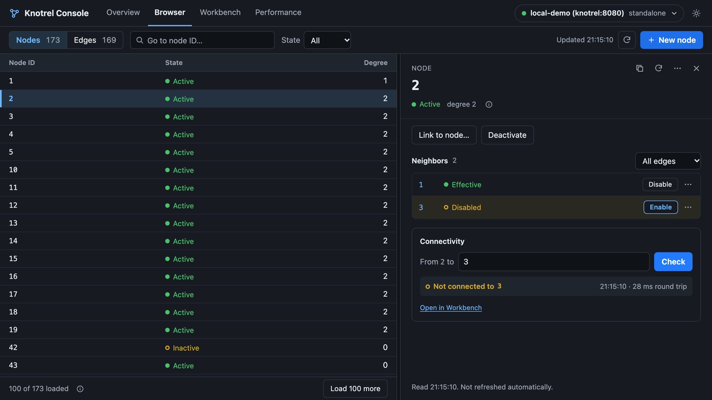

# Knotrel

[](https://github.com/knotrel/knotrel/releases)
[](LICENSE.md)
[](https://github.com/knotrel/knotrel/actions/workflows/ci.yml)
[](https://github.com/knotrel/knotrel/actions/workflows/lint.yml)
[](https://github.com/knotrel/knotrel/actions/workflows/vulnerabilities.yml)
[](https://codecov.io/gh/knotrel/knotrel)
[](https://sonarcloud.io/summary/new_code?id=knotrel_knotrel)
[](https://sonarcloud.io/summary/new_code?id=knotrel_knotrel)
[](https://sonarcloud.io/summary/new_code?id=knotrel_knotrel)

**Know whether your network stays connected as its topology changes.**

Knotrel is an in-memory engine for exact connectivity in undirected graphs.
Add or remove connections, take nodes offline and restore them, then check
whether two endpoints remain connected. Use it as a Rust library or an HTTP
service alongside your existing database.

**Latest release: [v0.8.0](https://github.com/knotrel/knotrel/releases/tag/v0.8.0)**
(operational console and opt-in inspection routes). Node/edge lifecycle is opt-in and supported on
`compact-bfs` only.

## Quickstart: a failure and a recovery

Two routes connect a source to a destination:

```text
             A (2)
            /     \
Source (1)         Destination (4)
            \     /
             B (3)
```

Take A offline: B keeps the endpoints connected. Take B offline too: the
connection is lost. Restore A: the connection returns without recreating its
configured edges.

Download and extract the **v0.8.0** server for your platform from the
[release assets](https://github.com/knotrel/knotrel/releases/tag/v0.8.0),
[verify its checksum](#installing-a-release), and clone this repository for the
example. With Python 3.9 or newer, run from the repository root:

```sh
python3 examples/quickstart/network_demo.py /absolute/path/to/knotrel-server
# Windows: py examples/quickstart/network_demo.py C:\path\to\knotrel-server.exe
```

Expected output:

```text
Two available paths: connected=true
A offline; B still available: connected=true
A and B offline: connected=false
A restored: connected=true
PASS: all expected responses verified; temporary server will stop.
```

The [script](examples/quickstart/network_demo.py) checks every HTTP response,
starts its own server on an automatically assigned loopback port, and stops it
on completion or failure. It explicitly uses standalone mode, `compact-bfs`
and `KNOTREL_TOPOLOGY_LIFECYCLE=true`. No existing graph is modified. This is
volatile demo state: exiting the process loses the graph.

To build the current checkout instead, use
`cargo build --release --locked -p knotrel-server`, then pass
`target/release/knotrel-server` to the same script (`.exe` on Windows).
CI runs this exact script against the built server.

This demonstrates **topological connectivity**, not electrical power flow,
voltage, protection behavior or whether a customer actually has power. The
[power-grid tutorial](docs/tutorials/power-grid.md) provides a larger example.

## When Knotrel helps

- Devices and connections go out of service and return, while applications
  repeatedly ask whether endpoints still have a path between them.
- You need exact connectivity in the currently applied graph, with explicit
  versions and source synchronization rather than periodic recomputation.
- You want an embedded Rust library or a local HTTP service alongside your
  authoritative database.

For insertion-only graphs, union-find may suffice. For infrequent queries,
BFS or DFS over your existing data may be simpler. Knotrel does not provide
persistent graph storage, directed reachability or electrical simulation.

## Rust library

`knotrel-core` is synchronous and has no HTTP or async dependencies.

```toml
[dependencies]
knotrel-core = "0.6.0"
```

```rust
use knotrel_core::{ConnectivityGraph, EngineConfig};

fn main() -> Result<(), Box<dyn std::error::Error>> {
    let mut graph = ConnectivityGraph::new(EngineConfig::CompactBfs);

    graph.add_node(1)?;
    graph.add_node(2)?;
    graph.link(1, 2)?;

    assert!(graph.connected(1, 2)?);

    graph.cut(1, 2)?;
    assert!(!graph.connected(1, 2)?);

    Ok(())
}
```

See runnable Cargo examples in [`crates/knotrel-core/examples`](crates/knotrel-core/examples):
- `cargo run -p knotrel-core --example basic`
- `cargo run -p knotrel-core --example bulk_import`
- `cargo run -p knotrel-core --example engine_selection`

## Integration model

- **Your database or event source owns the authoritative graph.** Knotrel holds
  derived, reconstructible state in memory; it has no durable graph
  persistence.
- **Restart means rebuild.** All graph data is lost when the process exits;
  restarting with another engine does not migrate data. In source-managed mode
  (`KNOTREL_MODE=source_managed`) an external feeder publishes a snapshot and
  then ordered events, and readiness reports `uninitialized` until it does.
- **The reference feeder is an example, not a production connector.**
  [`external_feeder`](crates/knotrel-server/examples/external_feeder.rs) and the
  [example container](examples/container/) demonstrate the protocol; adapting it
  to your source, retention and ownership rules is your responsibility.

See the [integration contract](docs/integration-contract.md) and the
[deployment runbook](docs/deployment.md) for sessions, leases, readiness states
and the restart/rebuild procedure.

> **Security boundary:** Knotrel has **no built-in authentication, authorization
> or TLS**. Anyone who can reach the listener can read and mutate the graph. It
> listens on loopback by default and refuses a non-loopback address unless
> `KNOTREL_ALLOW_NON_LOOPBACK=true`. Run it inside a trusted deployment boundary,
> or behind an external gateway that you configure separately; no gateway is
> included or configured by Knotrel. A private network alone is not sufficient;
> see the [trust model](docs/http-api.md#trust-model).

## Choosing an engine

Select an engine with `KNOTREL_ENGINE` (server) or
[`EngineConfig`](crates/knotrel-core/src/configuration.rs) (library). No engine
is fastest for every topology and operation mix; measure your own workload.

| Engine | Status | Costs (logical) | Consider it for | Design |
| --- | --- | --- | --- | --- |
| `compact-bfs` / `EngineConfig::CompactBfs` | **Default** | Queries $O(V + E)$ worst case; link/cut $O(\deg u + \deg v)$ amortized; memory $O(V + E)$ | General and mutation-heavy workloads; simplest, lowest memory | [ADR 0004](docs/architecture/0004-compact-core.md) |
| `ett` / `EngineConfig::EulerTour` | Experimental, opt-in | Queries $O(\log V)$; tree cuts may scan non-tree edges of the smaller side | Query-heavy workloads on tree-like topologies | [ADR 0005](docs/architecture/0005-experimental-euler-tour-forest.md), [0006](docs/architecture/0006-candidate-pruning.md) |
| `hdt` / `EngineConfig::Hdt` | Experimental, opt-in | Queries $O(\log V)$; updates $O(\log^2 V)$ amortized; memory $O(E + V \log V)$ | Dense graphs with frequent bridge cuts | [ADR 0008](docs/architecture/0008-experimental-hdt.md) |

Library callers can also reuse traversal scratch space with the opt-in
`BfsWorkspace`, and compare against the original ordered-adjacency
`ReferenceGraph`. Bounds describe internal structures: external `u64` IDs use
hash maps with expected, not worst-case, $O(1)$ lookups, and logical memory does
not bound heap or RSS because capacity is retained after cuts. Amortized bounds
are not per-request latency guarantees. Only `compact-bfs` and its workspace
variant were measured in v0.3.0 release qualification. See
[startup engine configuration](docs/architecture/0007-startup-engine-configuration.md).

### Node and edge lifecycle

Since v0.5.0, opt-in lifecycle supports reversible node activation, reversible
edge enabling and permanent node removal, **only on `compact-bfs`**. Select
`KNOTREL_TOPOLOGY_LIFECYCLE=true` for the server or `LifecycleGraph` in Rust.
The server rejects lifecycle with experimental `ett` or `hdt` engines.

See the [lifecycle contract](docs/topology-lifecycle.md) for operations,
configured versus effective edges, errors, costs and resource limits, and the
[HTTP API](docs/http-api.md) for request formats. HTTP node IDs are decimal
strings preserving the full `u64` range.

## Performance evidence

**[knotrel-benchmarks](https://github.com/knotrel/knotrel-benchmarks)** holds
the reproducible workloads, methodology and published reports: release
regression qualification, engine/competitor comparisons and algorithm
experiments, each labelled with the version and host it actually measured.
[Performance by version](docs/performance-by-version.md) summarizes, for
users, the comparison of the current release with the previous minor release
(v0.7.0 candidate against v0.6.0), with its limits. Earlier comparisons are
kept separately in the [performance history](docs/performance-history.md);
they were separate campaigns and are not comparable with each other. The authoritative statements are in the release notes for
[v0.4.0](docs/releases/v0.4.0-release-notes.md#regression-qualification-against-v030)
and [v0.3.0](docs/releases/v0.3.0-release-notes.md#performance-qualification).
No speedup is claimed for either release. The v0.5.0 qualification
did not pass unconditionally: its regressions and unresolved or inconclusive
results are accepted by maintainer waivers for v0.5.0 only, as recorded in the
[release notes](docs/releases/v0.5.0-release-notes.md#performance-qualification);
no speedup is claimed. v0.6.0 reduces import memory
and makes core flagged imports and fresh-ID churn measurably faster, but its
qualification did not pass unconditionally; its non-PASS results are accepted
as disclosed limitations
([release notes](docs/releases/v0.6.0-release-notes.md#performance-qualification)).
v0.7.0 runs read-only requests in parallel: read-heavy
throughput is about 2× v0.6.0 with 4 clients, and 4.5–5× for queries during
imports or feeder events at 100k nodes. Its qualification was **accepted
with exceptions**, not passed unconditionally. Three inconclusive results
and two unqualified lifecycle requirements on a hub topology are accepted
for v0.7.0 only
([release notes](docs/releases/v0.7.0-release-notes.md#performance-qualification)).
v0.8.0 is not performance-qualified, by maintainer decision: no
performance statement is made for it; its new server features are opt-in
([release notes](docs/releases/v0.8.0-release-notes.md#performance-qualification)).

## Installing a release

**Versions.** `knotrel-core`, `knotrel-server` and the
[console](docs/console.md) share one version number (lockstep): each release
publishes all three with the same version, even a component that did not
change. Use the console with the server of the same version.

Download the archive and checksum for your platform from the
[GitHub Releases page](https://github.com/knotrel/knotrel/releases) and verify
the SHA-256 checksum before running.

```sh
# Verify checksum on Linux:
sha256sum -c knotrel-server-v0.8.0-x86_64-unknown-linux-gnu.tar.gz.sha256
# Or on macOS:
# shasum -a 256 -c knotrel-server-v0.8.0-aarch64-apple-darwin.tar.gz.sha256

# Extract and start on Linux (x86_64):
tar -xzf knotrel-server-v0.8.0-x86_64-unknown-linux-gnu.tar.gz
cd knotrel-server-v0.8.0-x86_64-unknown-linux-gnu
./knotrel-server

# Or on macOS (Apple Silicon):
# tar -xzf knotrel-server-v0.8.0-aarch64-apple-darwin.tar.gz
# cd knotrel-server-v0.8.0-aarch64-apple-darwin
# ./knotrel-server
```

On Windows (PowerShell):
```powershell
# Compare the displayed hash with the downloaded .sha256 file before extracting.
Get-FileHash -Algorithm SHA256 knotrel-server-v0.8.0-x86_64-pc-windows-msvc.zip
Get-Content knotrel-server-v0.8.0-x86_64-pc-windows-msvc.zip.sha256
Expand-Archive knotrel-server-v0.8.0-x86_64-pc-windows-msvc.zip -DestinationPath .
cd knotrel-server-v0.8.0-x86_64-pc-windows-msvc
.\knotrel-server.exe
```

## Configuration and operation

Configuration is read once at startup from environment variables; it cannot be
changed through requests. Invalid values and unknown `KNOTREL_` variables stop
startup.

| Variable | Default | Meaning |
| --- | --- | --- |
| `KNOTREL_ADDR` | `127.0.0.1:8080` | IP address and port; non-loopback needs `KNOTREL_ALLOW_NON_LOOPBACK=true` |
| `KNOTREL_ALLOW_NON_LOOPBACK` | `false` | `true` permits a non-loopback `KNOTREL_ADDR` (no auth/TLS; see [trust model](docs/http-api.md#trust-model)) |
| `KNOTREL_MODE` | `standalone` | `standalone` or `source_managed`; the latter requires an external feeder |
| `KNOTREL_ENGINE` | `compact-bfs` | `compact-bfs`, experimental `ett` or `hdt` |
| `KNOTREL_MAX_PENDING_JOBS` | `32` | Positive limit on queued plus running graph jobs |
| `KNOTREL_MAX_NODES` | `100000` | Maximum registered nodes; zero allowed; `unlimited` opts out |
| `KNOTREL_MAX_EDGES` | `500000` | Maximum live edges (registered edges with lifecycle support); zero allowed; `unlimited` opts out |
| `KNOTREL_TOPOLOGY_LIFECYCLE` | `false` | `true` enables node activation, edge enabling and node removal; requires `KNOTREL_ENGINE=compact-bfs` (startup fails with `ett` or `hdt`); see the [lifecycle contract](docs/topology-lifecycle.md) |
| `KNOTREL_INSPECTION` | `false` | `true` enables the read-only inspection routes (`GET /v1/nodes`, `/v1/nodes/{node}`, `/v1/nodes/{node}/edges`, `/v1/edges`) used by the console's data browser; since v0.8.0; see [Inspection](docs/http-api.md#inspection-opt-in) |
| `RUST_LOG` | `info` | Logging filter |

For example, to opt into the experimental forest:

```sh
KNOTREL_ENGINE=ett KNOTREL_MAX_PENDING_JOBS=16 \
  cargo run --release --locked -p knotrel-server
curl -sS http://127.0.0.1:8080/v1/info
```

Further timeouts and size limits are listed under
[startup configuration](docs/http-api.md#startup-configuration-and-engine-selection).

- **Probes:** `GET /health` is liveness only. `GET /ready` reports `ready`, or
  503 `starting`, `draining` or `unavailable`; in source-managed mode also
  `uninitialized`, `loading`, `catching_up`, `stale` or `desynchronized`.
- **Shutdown:** on Unix, SIGINT or SIGTERM makes the server unready, rejects new
  graph work with 503 `shutting_down`, lets admitted requests finish and exits
  0; it exits 2 if the drain deadline expires, and a second signal forces exit
  130. On Windows, shutdown uses Ctrl+C or platform termination. See
  [lifecycle details](docs/http-api.md#lifecycle-health-and-shutdown).
- **Cardinality limits:** a rejected operation changes nothing, including
  implicitly created endpoints. Duplicate vertices and edges remain successful
  no-ops; cuts free edge capacity but retain vertices. Limits are not RAM
  limits. Embedded callers use `ConnectivityGraph::with_limits`; see
  [ADR 0009](docs/architecture/0009-graph-limits.md) for embedder and migration
  notes.
- **Inspection:** `GET /v1/info` reports the fixed engine and limits
  without entering the graph queue. `GET /v1/stats` returns a coherent snapshot
  of counts, remaining capacity and a decimal-string `state_version` that
  advances once per effective operation and resets on restart; it can return
  503 `busy`. See the
  [snapshot contract](docs/http-api.md#live-graph-snapshot-versus-instance-information).

## Operational console

A browser console (since v0.8.0; same version as the server) explores, queries and
diagnoses one server: node and edge browser, workbench, performance from
metrics. See [the console documentation](docs/console.md).



## Documentation

- [HTTP API](docs/http-api.md) and [OpenAPI specification](docs/openapi.yaml): operations, batch semantics, limits and errors.
- [Power-grid tutorial](docs/tutorials/power-grid.md): runnable topology demonstration of connectivity loss and restoration over the HTTP API.
- [Node and edge lifecycle contract](docs/topology-lifecycle.md): opt-in activation, enabling and removal semantics, costs and limits.
- [Integration contract](docs/integration-contract.md): source-managed mode, feeder sessions, imports, events and readiness.
- [Deployment runbook](docs/deployment.md): example container, reference feeder, restart and rebuild.
- [Operational console](docs/console.md) (since v0.8.0; same version as the server): browser UI, container image and static archive for operating one server; [console release procedure](docs/releases/console-release.md).
- [Architecture decisions](docs/architecture/0001-foundation.md): contracts, costs and scope, starting with ADR 0001.
- [v0.8.0 release notes](docs/releases/v0.8.0-release-notes.md), [v0.7.0](docs/releases/v0.7.0-release-notes.md), [v0.6.0](docs/releases/v0.6.0-release-notes.md), [v0.5.0](docs/releases/v0.5.0-release-notes.md), [v0.4.0](docs/releases/v0.4.0-release-notes.md) and [v0.3.0](docs/releases/v0.3.0-release-notes.md) release notes: scope, qualification outcomes, platform coverage and limitations.
- [v0.2.0](docs/releases/v0.2.0-release-notes.md) and [v0.1.0](docs/releases/v0.1.0-release-notes.md) release notes, and the [v0.1.0 scope](docs/releases/v0.1.0-scope.md).
- [Release procedure](docs/releases/release-procedure.md): verification, packaging and authorized publication.
- [Contributing](CONTRIBUTING.md): quality and documentation requirements.
- [knotrel-benchmarks](https://github.com/knotrel/knotrel-benchmarks): workloads, methodology and reports. Keep its clone beside this repository to run it locally.

Authentication, persistence, multiple graph namespaces and distributed execution
are not implemented.

## Development and quality gates

| Crate | Responsibility |
| --- | --- |
| `knotrel-core` | Synchronous graph operations and exact connectivity |
| `knotrel-server` | Axum HTTP API, validation and bounded blocking graph work |

Rust **1.100.0**, edition **2024**, and Cargo resolver **3** are pinned for the
workspace and server. The `knotrel-core` minimum supported Rust version (MSRV)
is **1.98.1**. The toolchain file installs Clippy and rustfmt when using rustup.
Cargo.lock records the resolved dependency versions.

```sh
cargo fmt --all -- --check
cargo clippy --workspace --all-targets --locked -- -D warnings
cargo clippy --workspace --all-targets --locked --features knotrel-server/test-support -- -D warnings
cargo test --workspace --locked
cargo test --workspace --locked --features knotrel-server/test-support
cargo +1.98.1 test --locked -p knotrel-core
RUSTDOCFLAGS='-D warnings' cargo doc --workspace --no-deps --locked
# Run in a disposable checkout: this script removes target/package.
./scripts/verify-source-packages.sh
./scripts/smoke-test-release-binary.sh
```

Public items require English Rustdoc. Nontrivial private algorithms also require
documentation of invariants, correctness and complexity. Workspace lints enforce
missing docs and forbid unsafe code; each crate inherits them explicitly.
CI builds and tests on Linux, Windows and macOS; formatting, Clippy and Rustdoc
gates run on Linux.
