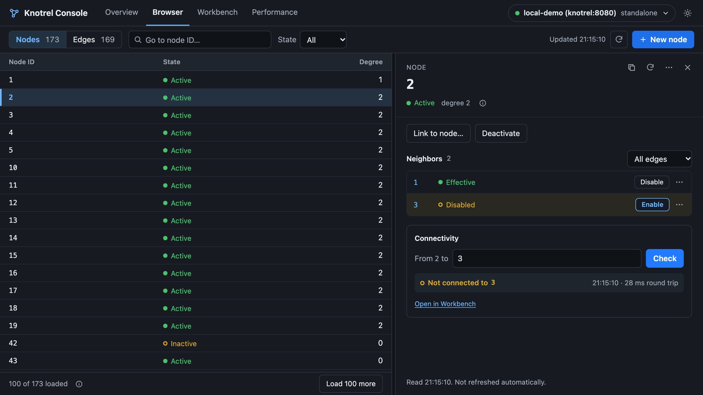

# Knotrel Console



Browser console for exploring, querying and diagnosing one
[Knotrel](https://github.com/knotrel/knotrel) server: a node and edge browser
with a detail pane and contextual operations, a workbench for queries and
batches, a performance view from metrics, an overview and synchronization
status.

The console works with any server. Three optional server flags unlock more of
it (the Compose example turns them all on):

| Server flag                       | Unlocks                                           | Default                |
| --------------------------------- | ------------------------------------------------- | ---------------------- |
| `KNOTREL_INSPECTION=true`         | The node and edge browser                         | off (no cost when off) |
| `KNOTREL_TOPOLOGY_LIFECYCLE=true` | Active/enabled/effective states and their actions | off                    |
| `KNOTREL_METRICS_ENABLED=true`    | The Performance page                              | off                    |

Why each is optional, and what it costs: [docs/console.md](../docs/console.md#server-flags-in-short).

> **Status: released.** Console 0.8.0 was released together with server 0.8.0
> (2026-11-21).

**Versions.** The console has the same version as the server (lockstep):
use console 0.8.0 with server 0.8.0. With server 0.7, every page except the
Browser works (server 0.7 has no inspection API).

The console ships as a container image (nginx serving the UI and forwarding
`/api` to one Knotrel server) and as a static archive for your own web
server. Full reference: [docs/console.md](../docs/console.md). Development:
[DEVELOPER.md](DEVELOPER.md).

## Quick start: server and console together

Two convenience scripts (macOS, Linux; they work from any directory) start
and stop a local server and the console with Docker Compose:

```sh
console/scripts/start-local.sh            # start (builds images the first time) and wait until ready
console/scripts/start-local.sh --build    # rebuild after code changes, then start
console/scripts/seed-demo.sh              # load a small demo network (the graph starts empty)
console/scripts/stop-local.sh             # stop and remove everything
```

Open <http://127.0.0.1:7380/>. Only the console is published, on loopback;
the server is reachable only from the console container. Graph data lives in
memory and is lost when the server stops.

`seed-demo.sh` sends two `POST /v1/batch` requests through the console:
173 nodes (a chain, a ring, a hub with 150 spokes, five 20-digit or huge IDs,
isolated nodes), one disabled edge (2–3) and two inactive nodes (42, 105).
Running it again is harmless. Pass another base URL to seed a different
server, for example `console/scripts/seed-demo.sh http://127.0.0.1:7379`.

A first tour once the demo network is loaded:

1. **Browser**: page through nodes; set **State** to Inactive (42, 105); go to
   `18446744073709551615`; open hub `100` and page through its 150 neighbors.
   Drag the divider to resize the detail pane.
2. Open node 2: edge 2–3 is disabled. In **Connectivity**, check target `3`:
   not connected.
3. Press **Enable** on neighbor 3 and check again: connected.
4. **Workbench**: send a batch with a deliberate error and look at the
   per-operation results, the raw view and **Copy as curl**.
5. **Performance** fills in after a few seconds; **Overview** should report
   nothing that needs attention.

The same stack with plain Docker Compose (also on Windows), from the
repository root:

| Task                | Command                                                         |
| ------------------- | --------------------------------------------------------------- |
| Start               | `docker compose -f console/deploy/compose.yaml up -d --build`   |
| Status and health   | `docker compose -f console/deploy/compose.yaml ps`              |
| Follow console logs | `docker compose -f console/deploy/compose.yaml logs -f console` |
| Follow server logs  | `docker compose -f console/deploy/compose.yaml logs -f knotrel` |
| Pause / resume      | `docker compose -f console/deploy/compose.yaml stop` / `start`  |
| Stop and remove     | `docker compose -f console/deploy/compose.yaml down`            |

## Get the image

Pull it from GitHub Container Registry:

```sh
docker pull ghcr.io/knotrel/knotrel-console:0.8.0
```

To test local changes, build it from the repository root:

```sh
docker build -t knotrel-console:dev console
```

Use `knotrel-console:dev` in place of `ghcr.io/knotrel/knotrel-console:0.8.0`
in the commands below. Images are tagged by version; `latest` is used only
for stable releases.

## Run the console against a server

The container must reach the server over a Docker network. This example also
starts a server from the repository's example image (run from the repository
root):

```sh
docker build -f examples/container/Dockerfile -t knotrel-server:example .
docker network create knotrel
docker run -d --name knotrel --network knotrel -e KNOTREL_MODE=standalone knotrel-server:example
docker run -d --name knotrel-console --network knotrel \
  -p 127.0.0.1:7380:8080 \
  -e KNOTREL_UPSTREAM=http://knotrel:8080 \
  --read-only --tmpfs /tmp --cap-drop ALL \
  ghcr.io/knotrel/knotrel-console:0.8.0
```

Open <http://127.0.0.1:7380/>. If your server already runs in another
container, attach the console to that container's network and point
`KNOTREL_UPSTREAM` at it.

### Stop, restart, remove

```sh
docker stop knotrel-console           # stop
docker start knotrel-console          # start again with the same settings
docker rm -f knotrel-console          # remove (the configuration lives in the run command)
docker rm -f knotrel && docker network rm knotrel   # remove the example server and network
```

To upgrade, pull the new version, remove the container and run it again
with the new tag. The console keeps no state.

### Logs and health

```sh
docker logs -f knotrel-console                    # follow console logs
docker ps --filter name=knotrel-console           # STATUS shows (healthy) or (unhealthy)
curl http://127.0.0.1:7380/healthz                # prints "ok" while nginx is up
```

Logs show the startup check (`forwarding /api to …`) and one line per request:
client address, method, path without query string, status, size and
duration. Request bodies, headers and credentials are never logged. Startup
errors also appear here, for example an invalid `KNOTREL_UPSTREAM`.

`/healthz` checks the console container only. Server state is shown in the
UI (Overview → Liveness and readiness).

## Configuration

| Variable                       | Default                     | Meaning                                                                                      |
| ------------------------------ | --------------------------- | -------------------------------------------------------------------------------------------- |
| `KNOTREL_UPSTREAM`             | required                    | Server base URL, e.g. `http://knotrel:8080`. Fixed at startup; the browser cannot change it. |
| `KNOTREL_CONSOLE_SERVER_NAMES` | `localhost 127.0.0.1 [::1]` | Host names the console answers to. Add your DNS name when a gateway forwards to it.          |
| `KNOTREL_CONSOLE_SERVER_LABEL` | the upstream URL            | Server name shown in the connection indicator (display only).                                |
| `KNOTREL_UPSTREAM_TIMEOUT`     | `35s`                       | Upstream timeout.                                                                            |
| `KNOTREL_CONSOLE_LISTEN`       | `8080 [::]:8080`            | Listen addresses; `127.0.0.1:8080` when a gateway shares the container's network namespace.   |

The container listens on port 8080 as an unprivileged user and supports a
read-only filesystem with a tmpfs at `/tmp`.

## Security

The console adds **no authentication**, and the Knotrel API has none. Keep
the published port on `127.0.0.1`. For remote access, put a gateway with TLS
and access control in front of it; see [docs/console.md](../docs/console.md#trust-boundary).
Only the console's own API routes are forwarded (reads, operations, batches,
inspection routes and `/metrics`); feeder endpoints are never reachable
through it.

## Troubleshooting

| Symptom                                        | Cause and fix                                                                                                      |
| ---------------------------------------------- | ------------------------------------------------------------------------------------------------------------------ |
| `compose.yaml: no such file or directory`      | The command ran outside the repository root. Use the scripts, or `cd` to the repository root first.                |
| Container exits right after start              | Invalid configuration: run `docker logs knotrel-console`, fix the variable and run it again.                       |
| Browser shows `421` / "unexpected Host header" | You opened it through a name not in `KNOTREL_CONSOLE_SERVER_NAMES`; add it.                                        |
| UI says "Server unreachable"                   | The server is down or not on the console's network. Check `KNOTREL_UPSTREAM` and `docker network inspect knotrel`. |
| `docker pull` fails                            | Check the tag (`0.8.0` or later) and network access to `ghcr.io`, or build it locally.                             |
| Port 7380 already in use                       | Publish another port, e.g. `-p 127.0.0.1:7381:8080`.                                                               |

## License

[Elastic License 2.0](../LICENSE.md).
