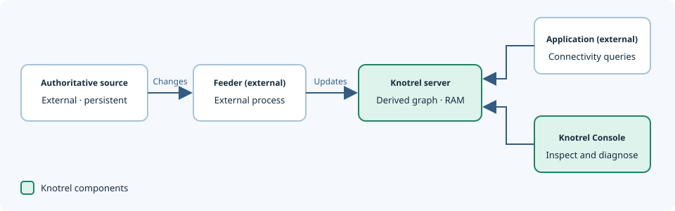
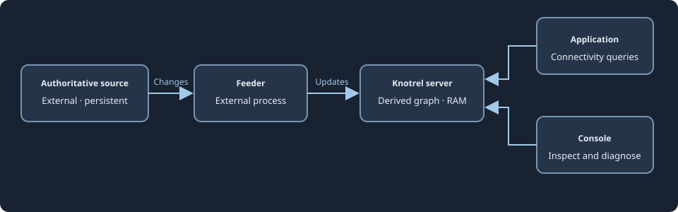

# Architecture

Editable draw.io sources: [light](diagrams/architecture.drawio) · [dark](diagrams/architecture-dark.drawio).

The external authoritative source owns the data. A feeder obtains a coherent image and delivers ordered changes. Knotrel maintains a derived, volatile graph; applications query the currently applied state. The console communicates with the server for inspection, queries and permitted operations. Synchronization lag means a successful source write is not necessarily visible immediately.

PostgreSQL has a [reference feeder](integrations/postgresql-feeder.md) (since v0.9.0): an external program that uses logical replication, not a connector inside Knotrel and not a requirement. See the [integration contract](integration-contract.md) and [deployment guide](deployment.md).

## Standalone mode

Clients issue graph operations and queries directly to the server. There is no external feeder or source synchronization; graph state is lost when the process stops. See the [HTTP API](http-api.md).
