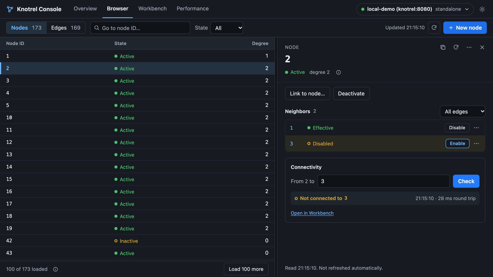
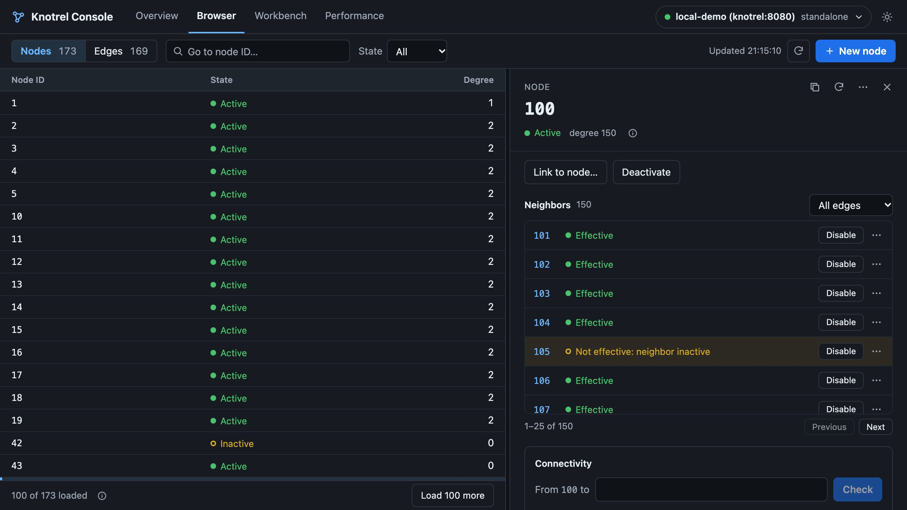
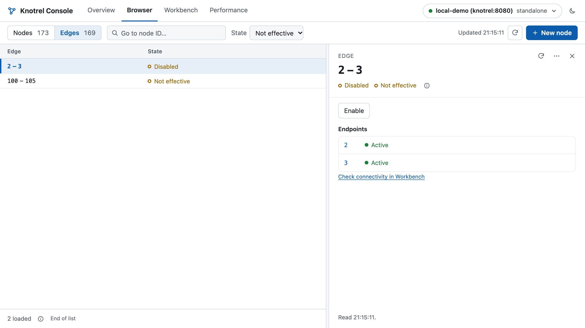
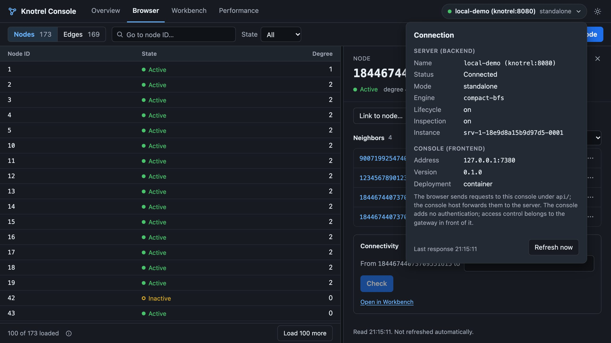
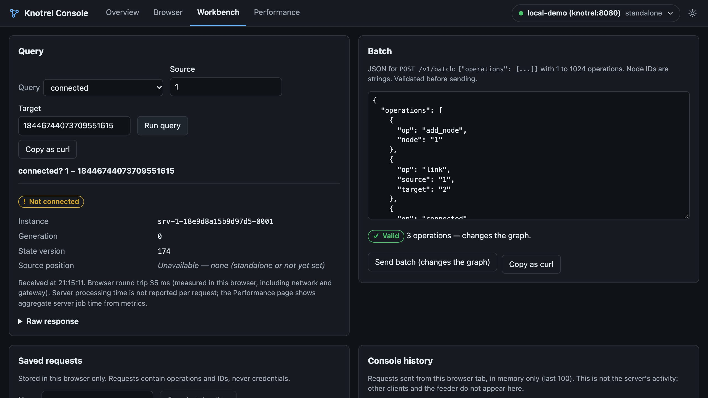
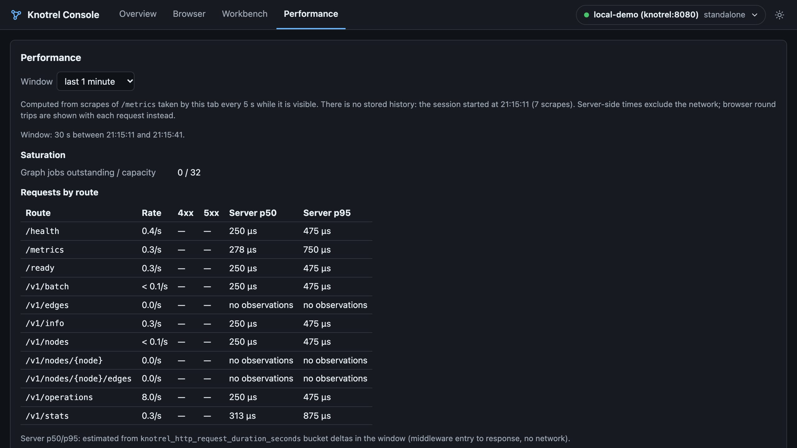
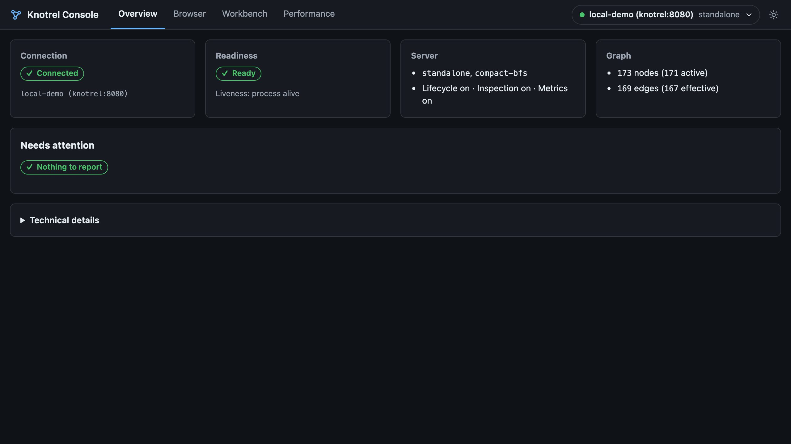

# Knotrel Console

The Knotrel Console is a browser tool for exploring, querying and diagnosing
one Knotrel server, modeled on the workflow of data browsers such as Redis
Insight:

- **Browser:** list nodes and edges without knowing their IDs, filter by state,
  find an exact ID, inspect a node's incident edges and act on the selection.
- **Workbench:** connectivity and state queries, a batch editor validated against
  the contract, raw responses, saved requests, console history and `curl`
  equivalents.
- **Performance:** request and error rates, admission rejections, latency and
  saturation computed from `/metrics`.
- **Overview** and, for source-managed servers, **Synchronization.**



> **Status: released (0.8.0, 2026-11-21)**, together with server 0.8.0.
> Image `ghcr.io/knotrel/knotrel-console:0.8.0` (`sha256:1c4ce3fda67acda0cb44dedd5a275fb19e5ab09dac2cce9a5dbc83c3f5f25f82`);
> archive on the [GitHub Release v0.8.0](https://github.com/knotrel/knotrel/releases/tag/v0.8.0).

The console is a static React application, released as its own artifacts
(never inside the Rust crates or binary) and distributed in two forms:

| Distribution | Use | Status |
| --- | --- | --- |
| Container image `ghcr.io/knotrel/knotrel-console:<version>` | Run next to Knotrel, locally or on a server | Primary; published since 0.8.0 |
| Static archive `knotrel-console-<version>.tar.gz` (+ `.sha256`) on the GitHub Release `v<version>` | Host behind an existing web server or gateway | Primary; published since 0.8.0 |
| npm package with a local launcher | `npx` quick start | Deferred (separate increment) |

The server binary, the console image and the archive are independent
artifacts. Cargo builds and server installations never need Node.js, and the
Rust binary embeds no console assets.

## Server flags, in short

The console works with any server. Three optional server flags unlock more of
it. Each is off by default because each has a cost that not every
deployment wants to pay.

| Flag | What it unlocks in the console | Cost when on | Off (default) |
| --- | --- | --- | --- |
| `KNOTREL_INSPECTION=true` | Browser: lists of nodes and edges, node detail, incident edges | Up to about 20 bytes per node and a few percent slower node creation (measured: 2–5 %) | No cost. The browser explains how to turn it on; queries and operations still work. |
| `KNOTREL_TOPOLOGY_LIFECYCLE=true` | Active/inactive nodes, enabled/disabled edges, removal, the related filters | Roughly twice the graph memory; `compact-bfs` only | Every node is active and every edge effective; those actions are hidden. |
| `KNOTREL_METRICS_ENABLED=true` | Performance page, feeder lease on the Synchronization page | Exposes `/metrics` (no authentication, like every route) | The pages say metrics are disabled. |

Incident edges and the edge list also need the `compact-bfs` engine (the
default): the experimental engines cannot list neighbors.

The Compose example turns all three on. Measured costs:
[inspection cost check](console-inspection-costs.md).

## Choose a path

- **[Local start with Docker](#local-start-with-docker):** a few commands start
  a server and the console on loopback.
- **[Install in your environment](#install-in-your-environment):** serve the
  static archive from your gateway, with your TLS and access control.

## Local start with Docker

Requirements: Docker with Compose. From a checkout of this repository:

```sh
docker compose -f console/deploy/compose.yaml up --build
```

Open <http://127.0.0.1:7380/>. The example starts a standalone server with
lifecycle support, inspection and metrics enabled. `console/scripts/start-local.sh`
and `stop-local.sh` wrap the same commands; `console/scripts/seed-demo.sh` loads a
small demo network, since the graph starts empty. Only the console port is published, on loopback;
the server is reachable only from the console container. Graph state is in
memory and lost when the server stops. Stop with Ctrl+C, then:

```sh
docker compose -f console/deploy/compose.yaml down
```

To use the console with a server you already run, start only the console
image (or an image built with
`docker build -t knotrel-console:dev console`):

```sh
docker run --rm -p 127.0.0.1:7380:8080 \
  -e KNOTREL_CONSOLE_UPSTREAM=http://host.docker.internal:8080 \
  --read-only --tmpfs /tmp --cap-drop ALL \
  ghcr.io/knotrel/knotrel-console:0.8.0
```

The server must be reachable from the container. A server bound to the host's
loopback is not reachable through `host.docker.internal` on Linux. Prefer a
shared Docker network, as in the Compose example. Do not expose an
unauthenticated server just to reach it.

### Container configuration

| Variable | Default | Meaning |
| --- | --- | --- |
| `KNOTREL_CONSOLE_UPSTREAM` | required | Server base URL, `http(s)://host[:port][/path]`, no credentials, query or trailing slash. Fixed for the container's lifetime. |
| `KNOTREL_CONSOLE_LISTEN` | `8080 [::]:8080` | Addresses the container listens on (space separated: port, `IPv4:port` or `[IPv6]:port`). Set `127.0.0.1:8080` when a gateway shares the container's network namespace, so only the gateway can reach it. The image's health check uses `127.0.0.1:8080`. |
| `KNOTREL_CONSOLE_SERVER_NAMES` | `localhost 127.0.0.1 [::1]` | Accepted `Host` names (space separated). Requests for any other host get 421. Add the public name when a gateway forwards to the container. |
| `KNOTREL_CONSOLE_SERVER_LABEL` | the upstream URL | Server name shown in the connection indicator (display only). |
| `KNOTREL_CONSOLE_UPSTREAM_TIMEOUT` | `35s` | Upstream send/read timeout. It exceeds the server's 30 s request timeout so that the server's `request_timeout` is reported when it applies. |

Every console variable is named `KNOTREL_CONSOLE_*`. The server reserves that
prefix for the console and ignores it, so one environment file can serve both
containers ([startup configuration](http-api.md#startup-configuration-and-engine-selection)).

**Deprecated aliases.** Before 1.0 the upstream variables were named
`KNOTREL_UPSTREAM` and `KNOTREL_UPSTREAM_TIMEOUT`; the new names are new in
1.0.0 (unreleased), and console images up to 0.9.x accept only the old ones.
The console still accepts the old names, throughout the 1.x series, as
aliases of `KNOTREL_CONSOLE_UPSTREAM` and `KNOTREL_CONSOLE_UPSTREAM_TIMEOUT`;
their removal follows the [deprecation rule](compatibility.md#4-deprecation).
For each pair, where an empty value counts as not set:

| New name | Alias | Result |
| --- | --- | --- |
| set | not set | The new name is used. |
| not set | set | The alias's value is used; a deprecation warning is written to stderr at startup. |
| set | set, same value | The new name is used; a deprecation warning is written to stderr at startup. |
| set | set, different value | The container refuses to start and names both variables. |
| not set | not set | The default applies (`KNOTREL_CONSOLE_UPSTREAM` is required: the container refuses to start). |

Refusing different values, rather than letting one name win, keeps an
outdated alias left in an environment file from silently redirecting, or
being silently overridden for, the console's only upstream.

Invalid values stop the container at startup. The image runs nginx as uid
101, listens on port 8080, works with a read-only root filesystem and a tmpfs
at `/tmp`, and has a health check on `/healthz`. That endpoint reveals nothing
about the server.

## Install in your environment

1. Download `knotrel-console-<version>.tar.gz` and its `.sha256` from the
   GitHub Release `v<version>` (the same release as the server), then verify
   and extract them:

   ```sh
   sha256sum -c knotrel-console-0.8.0.tar.gz.sha256
   tar -xzf knotrel-console-0.8.0.tar.gz
   (cd knotrel-console-0.8.0 && sha256sum -c SHA256SUMS)
   ```

2. Serve `knotrel-console-<version>/html/` as static files.
3. On the **same origin**, forward exactly these routes to one Knotrel server,
   stripping the `/api` prefix:

   | Console request | Server request | Used by |
   | --- | --- | --- |
   | `GET /api/health`, `GET /api/ready` | `GET /health`, `GET /ready` | Overview |
   | `GET /api/v1/info`, `GET /api/v1/stats` | `GET /v1/info`, `GET /v1/stats` | Overview, Browser counts |
   | `POST /api/v1/operations` | `POST /v1/operations` | Queries and operations |
   | `POST /api/v1/batch` | `POST /v1/batch` (allow 1 MiB bodies) | Workbench batches |
   | `GET /api/v1/nodes`, `GET /api/v1/nodes/{id}`, `GET /api/v1/nodes/{id}/edges`, `GET /api/v1/edges` | Same paths without `/api` | Browser |
   | `GET /api/metrics` | `GET /metrics` | Performance, Synchronization |

   Forward nothing else: feeder endpoints must not be reachable through the
   console origin. Do not retry upstream requests (`proxy_next_upstream off`
   in nginx): a retried mutation could be applied twice.
4. Put TLS and access control in front of both the UI and `/api`.
5. Optionally serve `console-config.json` next to `index.html`, for example
   `{"serverLabel":"knotrel-prod-1"}`, to show which server the gateway uses.

The archive includes `nginx/knotrel-console.conf`, a commented nginx example.
The console uses the relative prefix `api/`, so the same build works at `/` or
under a sub-path, with no rebuild per installation.

### Optional gateway signal

The bundled container sets `X-Knotrel-Console-Proxy` on answers it generates
itself. Your gateway may set it too:

| Value | Meaning | How the console treats a mutation |
| --- | --- | --- |
| `upstream_unreachable` | No byte reached the server (connection refused or connect timeout). | Not delivered (rejected). |
| `upstream_failed` | The connection failed after the request may have been sent. | Outcome uncertain. |
| `upstream_timeout` | No answer within the gateway timeout. | Outcome uncertain. |
| `rejected` | The gateway refused the request (route, method, origin, size). | Rejected. |

Without the header, a gateway error is shown as its plain HTTP status. A 5xx
answer to a mutation is then treated as uncertain.

## Trust boundary

- **The console adds no authentication.** Neither does the Knotrel API. Anyone
  who can load the console can read the graph and, on a standalone server, change
  it. Expose it only through a gateway that provides TLS and access control, or
  keep it on loopback for one trusted user.
- **The upstream is fixed by operator configuration.** The browser cannot name a
  server. Only the allowlisted routes are forwarded (the console's reads,
  operations, batches, inspection routes and `/metrics`), without cookies,
  `Authorization` or forwarding headers. Feeder routes are never forwarded.
- **Browser-origin attacks.** Binding to loopback does not stop a malicious web
  page from sending requests to `127.0.0.1`. The container answers only requests
  whose `Host` is an accepted name (421 otherwise), which defeats DNS rebinding.
  It rejects API requests whose `Origin` names another host or whose
  `Sec-Fetch-Site` is not `same-origin`, which defeats cross-site request forgery.
  A strict Content Security Policy forbids inline scripts and framing.
- **Bounds.** Request bodies are limited to 64 KiB (1 MiB for batches, the
  server's own limit). Upstream connect (5 s), send
  and read timeouts are bounded. Upstream responses are not size-limited by the
  container; the server's own responses are small.
- **Logs.** The container logs client address, method, path without query string,
  status, size and duration. It never logs bodies, headers, cookies or
  credentials.
- **Server-provided text** (error messages) is always rendered as text, never
  as HTML.

## Capabilities and API mapping

Every value comes from these endpoints. Values the API does not expose are
shown as "Unavailable", with the reason; they are never inferred.

| View | Endpoint | Fields used |
| --- | --- | --- |
| Overview | `GET /health`, `GET /ready`, `GET /v1/info`, `GET /v1/stats` | Liveness, readiness label, mode, engine, `topology_lifecycle`, `inspection`, counts, capacity; attention items derived from these and from metrics availability |
| Browser: lists | `GET /v1/nodes`, `GET /v1/edges` | Pages of nodes (ID, `active`, `degree`) and edges (`enabled`, `effective`), cursors, version headers per page |
| Browser: counts | `GET /v1/stats` | `node_count`, `active_node_count`, `edge_count`, `enabled_edge_count`, `effective_edge_count` |
| Browser: node detail | `GET /v1/nodes/{id}`, `GET /v1/nodes/{id}/edges` | Flags, registered degree, incident edges with `enabled`/`effective` |
| Browser: edge detail | `edge_state` via `POST /v1/operations`, `GET /v1/nodes/{id}` for both endpoints | Desired state (`enabled`) and effectiveness with the endpoints' `active` flags |
| Browser and Workbench operations | `POST /v1/operations`, `POST /v1/batch` | `changed`, error envelopes, per-operation batch results, `X-Knotrel-State-Version` |
| Workbench queries | `POST /v1/operations` | `connected`, `node_state`, `edge_state` and the version headers of the same response |
| Performance | `GET /metrics` | `knotrel_http_requests_total`, `knotrel_http_request_duration_seconds`, `knotrel_requests_rejected_total` (by `reason` and, from 1.0.0, `lane`), `knotrel_requests_outcome_uncertain_total`, `knotrel_graph_jobs_outstanding` and `knotrel_graph_job_capacity` (one row per `lane` from 1.0.0, each lane's outstanding count over that lane's capacity; one unlabelled row for earlier servers), job queue/lock-wait/execution histograms |
| Synchronization | `GET /v1/stats`, `GET /ready`, `GET /v1/info`, `GET /metrics` | `sync_status`, `generation`, `source_position`, state version, readiness label, `knotrel_feeder_lease_remaining_seconds`, `knotrel_feeder_last_applied_age_seconds` |

Not exposed, so shown as unavailable:
- the server software version;
- per-request server processing time (only aggregate job histograms exist);
- source lag (an opaque source position cannot be subtracted from a local
  revision);
- a request ID (the server logs one but does not return it).

### Mode and capability rules

| Server | Queries | Topology operations |
| --- | --- | --- |
| Standalone, lifecycle off | `connected` | `add_node`, `link`, `cut` |
| Standalone, lifecycle on (`compact-bfs`) | `connected`, `node_state`, `edge_state` | all six, including permanent removal (typed confirmation) |
| Source-managed | `connected` (and `node_state`/`edge_state` with lifecycle) | none. Changes belong in the authoritative source and its feeder. The console never sends session, heartbeat, import, event, gap or barrier requests. |

Unsupported actions are disabled with an explanation. They are not hidden
silently.

## Screens

Screenshots of the demo network (`console/scripts/seed-demo.sh`) at 1280×720.
To refresh them, start the local stack, load the demo network and run
`node console/scripts/capture-screenshots.mjs`; the script only runs queries.

**High-degree node.** Neighbors are paged in a bounded box, so the
connectivity check stays in view.



**Edges and the light theme.** The state filter lists edges that do not carry
connectivity; the detail shows the desired state, effectiveness and both
endpoints.



**Connection details.** The server (backend) and the console host the browser
talks to (frontend) are shown separately.



**Workbench.** Queries, a validated batch editor, saved requests and the console
history.



**Performance.** Rates and server-side latency per route, computed from
`/metrics` scrapes taken by this tab.



**Overview.** Connection, readiness, server configuration, graph counts and
what needs attention.



## Behavior

- **Layout.** The top bar holds the pages, the connection indicator and the
  theme switch (dark by default, light on request; the choice is kept in this
  browser). The connection indicator names the server and opens a panel that
  separates the server (backend: name, mode, engine, flags, instance) from the
  console host the browser talks to (frontend: address, version, deployment).
- **Browser layout.** A compact toolbar (Nodes/Edges with counts, go to an ID,
  state filter, reload, New node), a table that fills the available height,
  and a detail pane on the right whose width can be dragged or set with the
  arrow keys (kept in this browser). The node detail shows identity and state
  first, then neighbors in a bounded, paged box (25 per page), then a
  connectivity check from that node. Rare or destructive actions (remove a
  node, cut an edge) sit in a menu; technical explanations sit in info tips.
- **Browser lists are paged, never complete downloads.** Pages of 100 are loaded
  on demand, up to 5000 rows; empty pages produced by the server's scan budget
  are followed automatically (up to five per click). Each page is a coherent
  read with its own version headers, but the list is not a snapshot: elements
  present for the whole traversal appear exactly once, and elements changed
  meanwhile may or may not appear. If the instance or generation changes
  between pages, the list is flagged as mixing graphs and offers a restart.
  Lists are not refreshed automatically; after an operation from the console
  the list is marked as possibly out of date.
- **Selections and filters are in the URL** (`#/browser?view=edges&state=disabled&edge=1-2`),
  so a view can be shared and survives navigation between pages.
- **Contextual operations** are offered only when the mode and configuration
  allow them, with the reason otherwise. After each mutation the affected detail
  is read again; a node or edge that no longer exists is reported as such.
- **Batches** are validated before sending (shape, node IDs as strings within
  u64, self-loops, lifecycle and mode restrictions). Results are shown per
  operation as the server returns them: there is no rollback and no isolation
  beyond the single lock acquisition the server documents.
- **Console history** lists the requests sent from this browser tab (in memory,
  last 100). It is not the server's activity log and not an audit trail.
  **Saved requests** are kept in this browser's storage and contain no
  credentials. **Copy as curl** targets the console origin, never the upstream.
- **Performance** numbers come only from scrapes taken by this tab (every 5 s
  while visible, at most 15 minutes kept). Rates use reset-corrected counter
  increases and flag resets; latency quantiles are estimated from histogram
  bucket deltas over the chosen window. When `/metrics` answers 404, polling
  stops and the view says metrics are disabled.

- **Exact values.** Responses are parsed losslessly: JSON numbers keep their
  source text. Generations, counts and limits are shown as exact decimal strings,
  and node IDs and revisions are never converted to a JavaScript `number`. Node
  IDs must be ASCII digits up to 18446744073709551615. They are sent exactly as
  typed; the server normalizes leading zeroes, and the form says so.
- **Runtime validation.** Generated OpenAPI types describe shapes only. Every
  response is validated at runtime. Malformed or incompatible responses are
  reported as such. Unknown error codes are shown with their code, not dropped.
- **Independent reads.** The overview refreshes liveness, readiness,
  configuration and statistics as four independent requests, every 5 s while the
  page is visible. Each is shown with its own time and browser round-trip. Only
  `/v1/stats` and its headers form one coherent server snapshot; the page never
  claims that separate reads are atomic.
- **Bounded polling.** Refreshes never overlap. A manual refresh cancels the
  obsolete one. After errors the interval doubles up to 60 s. Polling pauses
  while the tab is hidden and refreshes immediately when it is shown again. Data
  older than three intervals, or from before a failed refresh, is marked stale.
- **Durations.** Displayed durations are browser round-trips. The API reports
  no server execution time.
- **Mutations.** Each mutation is sent once and never retried automatically.
  Outcomes are *effective* (`changed: true`, with the new state version), *no-op*,
  *rejected* (structured error or not delivered) or *uncertain*: a timeout,
  connection loss after sending, server `request_timeout` or an undecodable
  success. A timeout is not a rollback. After every mutation from the Browser
  the affected node or edge is read again, which shows the actual state when the
  outcome was uncertain.
- **Restarts.** A change of `X-Knotrel-Instance-Id` is announced. Earlier
  results describe the previous, in-memory instance.

## Compatibility

**Versioning rule.** The console, `knotrel-server` and `knotrel-core` share
one version number (lockstep) and are released together; use the console with
the server of the same version. With the previous server minor the console
still works except for features the server lacks. Console 0.9 was verified
against server 0.8.0 and 0.9.0. Console 1.0.0 (unreleased, release candidate)
was verified against a server built from the 1.0.0 candidate and against
server 0.9.0 (browser tests, Chromium and Firefox, 14 of 14 on each browser
for each server); with server 0.9 the Performance page shows one unlabelled
admission row, because per-lane metrics start with server 1.0.0.

Within a supported server version, the server flags decide what is available;
see [Server flags, in short](#server-flags-in-short).

The console declares the server versions it supports in
`console/package.json` (`knotrel.supportedServer`, currently `>=0.9.0 <1.1.0`).
It also records the SHA-256 of the `docs/openapi.yaml` revision it was
generated from (`knotrel.openapiSha256`), which the archive's
`console-manifest.json` repeats. CI fails when the generated types or that
digest are stale. Browser tests run against the server built from the same
commit. The server exposes no software version, so the console cannot check
compatibility at runtime; it reports incompatible responses instead.

## Verified platforms and limitations

| Area | Coverage |
| --- | --- |
| Browsers | Playwright against real servers on Linux: Chromium and Firefox (CI matrix). Locally also macOS. WebKit/Safari is not tested. |
| Container | Linux runners (amd64); the release builds linux/amd64 and linux/arm64, and smoke-tests the amd64 image. |
| Static build and archive | Built and unit-tested on Linux, macOS and Windows. CI checks that the three archives are byte-identical. |
| Accessibility | axe-core checks (WCAG 2 A/AA, serious and critical findings fail) and keyboard-only flows. This is not a full manual audit. |

Out of scope: global graph visualization (a local neighborhood view is not
implemented yet), path reconstruction, multi-server management, bulk import,
log streaming or search, a request profiler, historical metrics, an audit
system, authentication in the server, persistence and multi-graph.

## Development

See [console/README.md](../console/README.md) for commands and
[docs/releases/console-release.md](releases/console-release.md) for the
release procedure.
