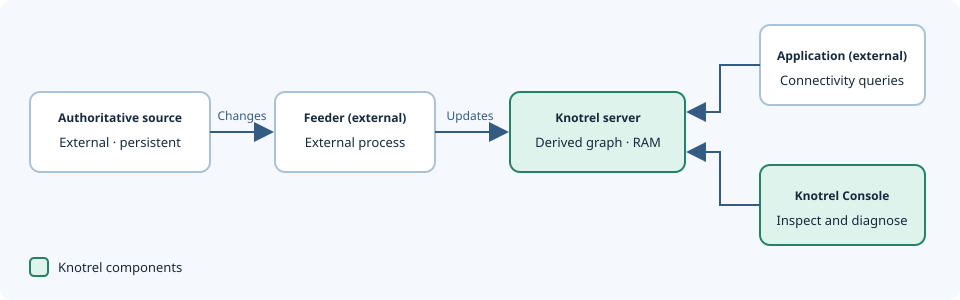

# Connectivity for changing networks

Knotrel keeps an undirected graph in memory and answers exact connectivity queries as nodes and edges change. Use it as a Rust library or HTTP service alongside your existing source of data.

[Get started](https://github.com/knotrel/knotrel#quickstart-a-failure-and-a-recovery) · [Console guide](console.md) · [HTTP API](http-api.md) · [Rust API](https://docs.rs/knotrel-core/latest/knotrel_core/)

## Architecture

The authoritative source and feeder are external. In source-managed mode, the feeder imports a graph and delivers ordered updates; Knotrel answers queries against its in-memory state. A [reference PostgreSQL feeder](integrations/postgresql-feeder.md) (logical replication, unreleased, planned for v0.9.0) shows a complete integration. In standalone mode, clients operate the graph directly. [Architecture details](architecture-site.md).

## Explore the documentation

- **Operate:** [Console](console.md), [deployment](deployment.md), [alerting](alerting.md).
- **Integrate:** [PostgreSQL reference feeder](integrations/postgresql-feeder.md) (unreleased).
- **Understand:** [Integration contract](integration-contract.md), [topology lifecycle](topology-lifecycle.md), [observability](observability-contract.md).
- **Build:** [HTTP API](http-api.md), [OpenAPI specification](openapi.yaml), [Rust crate documentation](https://docs.rs/knotrel-core/latest/knotrel_core/).
- **Evaluate:** [Performance by version](performance-by-version.md), [release notes](releases/v0.8.0-release-notes.md).

Knotrel is volatile: after a restart, rebuild or resynchronize from the authoritative source. It does not provide authentication; use a trusted boundary or gateway.
