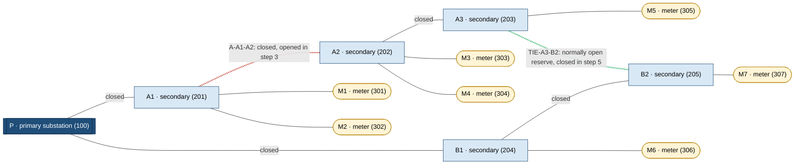

# Tutorial: connectivity loss and restoration in a synthetic power grid

This tutorial uses a small **synthetic** electrical distribution network to show
what Knotrel answers. It opens one connection, sees which customers lose their
path to the source, then closes a reserve connection and sees connectivity
return. Everything runs against the HTTP API of a Knotrel v0.5.0 server,
driven by Python 3 standard-library scripts. The first script uses only
operations available since v0.1.0, so it also runs against v0.3.0 and v0.4.0
servers. The optional observability step [below](#observe-the-run-optional)
needs v0.4.0 or later, and the
[lifecycle part](#take-a-substation-out-of-service-v050) needs v0.5.0 with
lifecycle support enabled.

> **Scope.** This is a topology demonstration, not an electrical simulator or
> an operational switching tool. The network is invented for teaching and is
> not a validated grid model.

## The question Knotrel answers

Knotrel keeps an undirected graph that changes over time and answers one exact
question: *is there currently any path between node X and node Y?*

In this tutorial the question is: *is this customer meter **topologically
connected** to the primary substation, or is there **no path to the assumed
source**?* The primary substation is treated as an available source. Generation
failures and multiple supplies are not modelled.

**Connectivity to the primary substation does not prove that a customer is
energized.** Knotrel does not calculate voltage, current, power flow, thermal
limits, protection coordination or switching safety. A topological path is a
necessary condition for supply in this model, not a sufficient one.

## The synthetic network

The dataset in [`examples/power-grid/grid.json`](../../examples/power-grid/grid.json)
has 13 nodes on two feeders from one primary substation:

- **Primary substation** P (`100`): the assumed source.
- **Secondary substations**: A1, A2, A3 on feeder A (`201`–`203`) and B1, B2 on
  feeder B (`204`, `205`).
- **Customer meters** M1–M7 (`301`–`307`).
- **Twelve normally closed connections**: feeder sections and service drops.
- **One normally open reserve connection**: `TIE-A3-B2`, between the ends of
  the two feeders.



Legend:
- Double-bordered box: primary substation.
- Rectangles: secondary substations.
- Rounded shapes: customer meters.
- Solid lines: normally closed connections.
- Red dotted line: the connection opened in step 3.
- Green dotted line: the normally open reserve, closed in step 5.

## Mapping the network to Knotrel

| Network concept | Knotrel graph |
| --- | --- |
| Substation or meter | Node with a decimal string ID, such as `"202"` |
| Closed connection | Edge present in the graph |
| Open connection | Edge **absent** from the graph |
| Opening a closed connection | `{"op":"cut","source":"201","target":"202"}` |
| Closing an open connection | `{"op":"link","source":"203","target":"205"}` |
| "Is meter M5 reachable from P?" | `{"op":"connected","source":"305","target":"100"}` |

An open switch is just an absent edge, so the normally open reserve is not sent
during the initial load. Closing it later is an ordinary `link`.

### Why node types stay outside the core

Names such as "Meter M5" and types such as `customer` are **application
metadata**. They live in the dataset and in the script, not in Knotrel. Knotrel
receives only node IDs and the undirected edges that are currently active. The
core has no typed nodes, and connectivity does not depend on them. The
application decides which nodes count as customers, which node is the source,
and what an answer means for its domain.

Finding every affected customer therefore takes **one connectivity query per
customer**. Knotrel has no "affected customers" endpoint. The script sends the
seven queries together in one query-only [batch](../http-api.md#batches), which
still runs seven `connected` operations.

## Run the demonstration

Start a fresh, dedicated standalone server in one terminal:

```sh
KNOTREL_MODE=standalone cargo run --release --locked -p knotrel-server
```

Then run the script from the repository root in another terminal:

```sh
python3 examples/power-grid/power_grid_demo.py
```

Pass `--url` to target another address; the default is
`http://127.0.0.1:8080`. See the
[example README](../../examples/power-grid/README.md) for options and exit codes.

The script runs a fixed sequence:

1. **Preflight and load.** It checks that the server is ready, empty and
   standalone. One batch then adds the 13 nodes and links the 12 closed
   connections.
2. **Query.** It asks whether each meter connects to P. All seven are connected.
3. **Open `A-A1-A2`** with `cut`. This splits feeder A between A1 and A2.
4. **Verify the outage.** A2 and A3 now have no path to P, so exactly meters
   M3, M4 and M5 (`303`, `304`, `305`) have **no path to the assumed source**.
   M1 and M2 still connect through A1, and M6 and M7 through feeder B.
5. **Close `TIE-A3-B2`** with `link`. A3 is now connected to B2 on feeder B.
6. **Verify the restoration.** M3, M4 and M5 are again topologically connected
   to P, through P–B1–B2–A3 (and A3–A2 for M3 and M4). All seven meters are
   connected.

The outage is not limited to the meters next to the opened connection: M5,
two sections downstream, also loses its path. The restoration path runs through
the other feeder, not back through the opened section.

Expected output, abridged:

```text
Loaded 13 nodes and 12 closed connections; reserve TIE-A3-B2 stays open (absent edge).
...
After opening: topological connectivity to Primary substation P (100)
  Meter M1 (301)     connected
  Meter M2 (302)     connected
  Meter M3 (303)     NO PATH to the assumed source
  Meter M4 (304)     NO PATH to the assumed source
  Meter M5 (305)     NO PATH to the assumed source
  Meter M6 (306)     connected
  Meter M7 (307)     connected
  check passed: customers without a path = Meter M3 (303), Meter M4 (304), Meter M5 (305)
...
All checks passed. Topological connectivity only: no voltage, current, power flow, thermal, protection or switching-safety analysis was performed.
```

**Closing the reserve connection is a scripted topology change, not a
recommendation for operating a real electrical network.** Whether a real tie can
be closed safely depends on load, protection and operating rules that are
entirely outside this example.

## Observe the run (optional)

v0.4.0 can export Prometheus metrics and writes one structured log line per
request. To see what the demonstration did from the server's side, start the
dedicated server with metrics enabled instead:

```sh
KNOTREL_MODE=standalone KNOTREL_METRICS_ENABLED=true cargo run --release --locked -p knotrel-server
```

**Logs.** Each request runs in a `request` span with a process-unique
`request_id` and the matched route. The server log shows one `handled request`
line per HTTP call the script makes, with its status and latency.

**Metrics.** After the script finishes, read the graph size and the operation
counts:

```sh
curl -s http://127.0.0.1:8080/metrics \
  | grep -E '^knotrel_graph_(nodes|edges) |^knotrel_graph_operations_total' \
  | grep -v ' 0$'
```

For one run against a fresh server, expect these lines, in any order:

```text
knotrel_graph_nodes 13
knotrel_graph_edges 12
knotrel_graph_operations_total{op="add_node",outcome="changed"} 13
knotrel_graph_operations_total{op="link",outcome="changed"} 13
knotrel_graph_operations_total{op="cut",outcome="changed"} 1
knotrel_graph_operations_total{op="connected",outcome="true"} 18
knotrel_graph_operations_total{op="connected",outcome="false"} 3
```

How the counts add up:
- **Nodes:** 13.
- **Links:** 12 closed connections plus the reserve, 13 in all.
- **Cuts:** one.
- **Edges:** 12 remain at the end.
- **Queries:** 21, three rounds of seven. Three of them, after the opening,
  report no path.

**Metrics show what the server executed, not what it means for the grid.**
They count operations; whether a customer is affected remains the
application's interpretation.

`/metrics` is unauthenticated and served on the same listener. Keep the server
on loopback. See the [observability contract](../observability-contract.md)
for every series and label.

## Take a substation out of service (v0.5.0)

Cutting connections one by one loses information: when the substation comes
back, the application must remember which connections were in service.
v0.5.0 adds **node and edge lifecycle** support, which keeps that state in
Knotrel. It is opt-in; start a fresh, dedicated server with it enabled:

```sh
KNOTREL_MODE=standalone KNOTREL_TOPOLOGY_LIFECYCLE=true cargo run --release --locked -p knotrel-server
```

Then run the lifecycle scenario:

```sh
python3 examples/power-grid/lifecycle_demo.py
```

The model separates **registered** topology from **effective** connectivity:

| Network concept | Knotrel lifecycle operation |
| --- | --- |
| Take a substation out of service, keeping its connections | `{"op":"set_node_active","node":"202","active":false}` |
| Mark one connection unavailable without deleting it | `{"op":"set_edge_enabled","source":"202","target":"203","enabled":false}` |
| Decommission a substation and all its connections | `{"op":"remove_node","node":"202"}` |
| Inspect a node or a connection | `{"op":"node_state","node":"202"}`, `{"op":"edge_state","source":"202","target":"203"}` |

A connection participates in connectivity only when it is registered,
enabled, and both of its endpoints are active. Deactivating a node never
changes the `enabled` flag of its connections.

The script runs five steps after the initial load:

1. **Deactivate A2.** A2 and everything reachable only through it lose their
   path: M3, M4 and M5. A2's four connections stay registered.
2. **Disable `A-A2-A3` while A2 is inactive.** Nothing changes yet for
   connectivity, but the flag is recorded and the revision advances.
3. **Reactivate A2.** `A-A1-A2` and A2's service drops return, so M3 and M4
   are connected again. `A-A2-A3` stays disabled, so M5 still has **no path to
   the assumed source**.
4. **Remove A2.** The node and all four of its connections are deleted,
   including the disabled one. M3, M4 and M5 have no path.
5. **Re-create A2.** `add_node` creates a fresh, isolated A2. None of its old
   connections return: `edge_state` reports them as not registered.

Expected output, abridged:

```text
Reactivating Secondary substation A2 (202) (set_node_active true)
  connection A-A2-A3: registered=True, enabled=False, effective=False
  connection A-A1-A2: registered=True, enabled=True, effective=True
...
  check passed: customers without a path = Meter M5 (305)
```

**Inactive and disabled objects still count against `KNOTREL_MAX_NODES` and
`KNOTREL_MAX_EDGES`.** Only removal frees capacity. Deactivating a substation
costs work proportional to its number of connections, and lifecycle mode keeps
extra bookkeeping in memory; see the
[lifecycle contract](../topology-lifecycle.md) for costs and limits.

As before, **this is topology, not electrical analysis.** An active, enabled
path says nothing about voltage, loading, protection or whether the operation
is safe on a real network.

## How the script handles failure

The script checks every HTTP status, every per-operation result and the
`X-Knotrel-State-Version` header. It exits nonzero on any unexpected result,
instead of printing an apparently successful scenario.

Requests use a bounded timeout. If a mutation times out or its response is
lost, the server may still have applied it (see
[Admission and cancellation](../http-api.md#admission-and-cancellation)). The
script then stops with exit code 5 and does not retry blindly. Restart the server
to return to a known empty graph.

The script never overwrites an existing graph. It refuses to start unless the
server is ready, runs in standalone mode, reports zero nodes and edges, and
reports `state_version` `"0"`. This preflight **assumes exclusive use** of the
server and is not a concurrency guarantee. Another client could change the
graph after the check, which is why the server must be dedicated to this
demonstration. Knotrel has no authentication, so keep the server on loopback
(see the [trust model](../http-api.md#trust-model)).

## Relation to an external source of truth

Here the script plays the application: it holds the topology and sends each
change itself. This uses **standalone mode**, where clients mutate the graph
directly through `/v1/operations` and `/v1/batch`. Standalone mode keeps the
first tutorial self-contained, with no feeder session, import or lease to
manage.

In a real integration, the authoritative topology lives elsewhere, for
example in a network model database or an event stream of switch states.
Knotrel holds only derived, in-memory state: a restart loses the graph and the
state must be rebuilt from that source. For that setting, Knotrel provides
**source-managed mode**, which:

- rejects direct mutations;
- accepts a baseline import followed by an ordered event stream from a feeder;
- reports readiness only after a synchronization barrier is verified.

See:

- [Integration contract](../integration-contract.md): sessions, imports, events,
  barriers and readiness.
- [Deployment runbook](../deployment.md): the example container, the reference
  feeder (an example, not a production connector), restart and rebuild.
- [HTTP API: mode rules](../http-api.md#mode-rules).

## Summary

- Knotrel answers exact "is there any path?" questions on a changing graph.
- Opening a connection is `cut`; closing one is `link`; an open switch is an
  absent edge.
- Domain meaning, such as node types, the source and customers, stays in the
  application.
- A path to the primary substation means *topologically connected*, not
  *energized*. No electrical quantity, limit or safety condition is evaluated.
